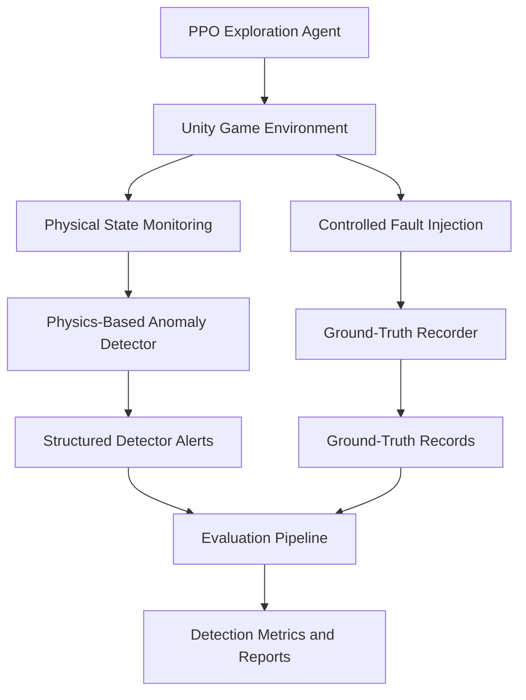

# **BUGSY**
### Reinforcement Learning-Based Automated Game Testing

**Explore autonomously. Detect anomalies. Investigate game bugs.**

BUGSY is a Unity-based automated game-testing framework that combines Proximal Policy Optimization (PPO)-driven novelty exploration with independent physics-based anomaly detection.

The framework enables an autonomous agent to explore game environments while a separate detection module monitors physical behaviour for potential inconsistencies. Controlled fault injection, ground-truth recording and structured experimental evaluation are used to investigate and assess detected anomalies.

---

## Table of Contents

1. [Project Overview](#-project-overview)
2. [Problem Statement](#-problem-statement)
3. [Key Features](#-key-features)
4. [System Architecture](#-system-architecture)
5. [Reinforcement Learning-Based Exploration](#-reinforcement-learning-based-exploration)
6. [Physics-Based Anomaly Detection](#-physics-based-anomaly-detection)
7. [Controlled Fault Injection](#-controlled-fault-injection)
8. [Evidence Collection and Logging](#-evidence-collection-and-logging)
9. [Experimental Evaluation](#-experimental-evaluation)
10. [Technology Stack](#-technology-stack)
11. [Project Structure](#-project-structure)
12. [Installation and Setup](#-installation-and-setup)
13. [Running BUGSY](#-running-bugsy)
14. [Evaluation Framework](#-evaluation-framework)
15. [Limitations](#-limitations)
16. [Future Work](#-future-work)

---

## 1. Project Overview

Traditional game testing often relies on manually designed test cases and predefined gameplay paths. Such approaches may fail to explore unexpected player interactions, unusual physical states and unintended gameplay behaviour.

BUGSY addresses this challenge through two independent but coordinated modules:

- **Autonomous Exploration:** A PPO-based reinforcement learning agent that explores the game environment using spatial novelty rewards.
- **Physics-Based Anomaly Detection:** A rule-based detection module that monitors player movement, velocity and collision-related behaviour to identify potential physics inconsistencies.

The exploration agent discovers different gameplay states, while the anomaly detector independently evaluates whether the resulting physical behaviour is consistent with the environment.

Controlled fault injection provides known anomalous conditions against which the detector can be evaluated.

The project is implemented and experimentally investigated in a Unity-based 3D parkour environment.

## 2. Problem Statement

Automated game testing faces two related challenges:

1. Autonomous agents must explore sufficiently diverse game states to uncover unexpected gameplay behaviour.
2. Discovering an unfamiliar state does not necessarily establish that a software or physics bug has occurred.

Novelty-driven exploration alone can identify unusual situations without determining whether they represent actual defects. Similarly, anomaly detection without appropriate exploration may fail to encounter important gameplay conditions.

BUGSY addresses these challenges by combining novelty-driven autonomous exploration with an independent physics-consistency detection mechanism.

## 3. Key Features

- **PPO-Based Autonomous Exploration:** Uses reinforcement learning to explore a Unity game environment.
- **Count-Based Spatial Novelty:** Encourages exploration of previously unvisited spatial cells.
- **Independent Physics-Based Detection:** Evaluates position, velocity and collider interactions using predefined rules.
- **Controlled Fault Injection:** Introduces teleportation and excessive velocity perturbations for testing.
- **Ground-Truth Recording:** Stores controlled injection events with unique identifiers and physical-state information.
- **Traceable Anomaly Reporting:** Associates detector alerts with experimental runs, trials and episodes.
- **Experimental Evaluation Pipeline:** Supports event matching, detection latency analysis, threshold sensitivity experiments, detector ablation and computational performance measurement.

## 4. System Architecture

BUGSY integrates two collaborative, decoupled modules operating within the same Unity parkour simulation:

| Subsystem | Component | Responsibility | Contributor |
|---|---|---|---|
| **Shared Simulation** | Unity Game Environment | Procedural parkour maze with dynamic obstacles & physics | Shared |
| **Shared Simulation** | GameManager | Episode lifecycle, player lives, state resets | Shared |
| **Autonomous Navigation** | BugsyAgent | PPO reinforcement learning policy driving player navigation | **Kezia** |
| **Autonomous Navigation** | CoverageTracker | Count-based spatial novelty tracking & intrinsic reward generator | **Kezia** |
| **Autonomous Navigation** | Navigation Suite | Baseline benchmarks, PPO training configs, evaluation figures | **Kezia** ([`navigation/`](navigation/)) |
| **Anomaly Detection** | BugsyAnomalyDetector | Rule-based physics invariant monitor (velocity, position, penetration) | **Nivedita** |
| **Anomaly Detection** | Fault Injectors | Controlled perturbations (teleportation, velocity spikes) | **Nivedita** |
| **Anomaly Detection** | BugsyGroundTruthRecorder | Synchronized injection event recorder with monotonic timestamps | **Nivedita** |
| **Anomaly Detection** | Evaluation Pipeline | Offline event matching, detection latency, sensitivity analysis | **Nivedita** ([`evaluation/`](evaluation/)) |

### System Workflow



The PPO agent and anomaly detector operate independently. The exploration policy determines the actions performed by the player, while the anomaly detector evaluates the resulting physical behaviour.

An unfamiliar state is not automatically classified as a bug.

## 5. Reinforcement Learning-Based Exploration

BUGSY uses Proximal Policy Optimization (PPO) to train an autonomous agent to explore the game environment.

### Exploration Strategy

The exploration mechanism uses count-based spatial novelty.

The maze floor is divided into spatial cells of size 3 × 3 Unity units. The agent receives an intrinsic reward when it enters a cell that it has not previously visited during the current episode.

The reward is represented as:

\[
r_t = \beta \cdot \mathbb{1}[g(s_{t+1}) \notin V_t]
\]

Where:

- \(r_t\) is the intrinsic reward.
- \(\beta\) is the novelty reward value.
- \(g(s_{t+1})\) represents the spatial cell occupied by the agent.
- \(V_t\) represents the set of previously visited cells.
- \(\mathbb{1}\) is the indicator function.

The current novelty reward value is 0.1.

### Observation Space

The agent receives a 43-component vector observation containing information such as:

- Normalized player position.
- Velocity components.
- Orientation.
- Grounded and sliding states.
- Previous action representations.
- A local 5 × 5 visited-cell map.

An additional ray-perception sensor provides information about nearby environmental objects.

### Action Space

The agent uses four discrete action branches:

| Action Branch | Available Actions |
|---|---|
| Movement | Stand, move forward |
| Jump | No jump, jump |
| Slide | No slide, slide |
| Turning | No turn, left, right |

### Training Configuration

The PPO model uses the following configuration:

| Parameter | Value |
|---|---:|
| Algorithm | PPO |
| Hidden layers | 2 |
| Hidden units | 128 |
| Batch size | 256 |
| Buffer size | 4096 |
| Learning rate | 0.0003 |
| Discount factor (\(\gamma\)) | 0.995 |
| GAE parameter (\(\lambda\)) | 0.95 |
| Training steps | 300,000 |

The trained model can be exported to ONNX and executed in Unity using inference mode.

## 6. Physics-Based Anomaly Detection

BUGSY incorporates an independent rule-based anomaly detection module implemented in `BugsyAnomalyDetector.cs`.

The detector continuously monitors the player's physical state and evaluates it against predefined physics-consistency criteria.

### Detection Rules

| Anomaly Category | Monitored Parameter | Detection Threshold |
|---|---|---:|
| Excessive Total Velocity | Magnitude of velocity vector | 20 units/s |
| Excessive Horizontal Velocity | Horizontal velocity magnitude | 12 units/s |
| Excessive Vertical Velocity | Absolute vertical velocity | 25 units/s |
| Position Discontinuity | Change in consecutive player positions | 2 units |
| Softlock | Movement speed and duration | Below 0.2 units/s for 5 seconds |
| Wall Penetration | Collider penetration depth and persistence | 0.05 units for 0.15 seconds |

These thresholds are implementation-specific detection parameters and are not intended to represent universal physical limits.

### Detection Mechanism

The detector evaluates physical conditions during Unity physics updates.

For example:

- Excessive total velocity is identified when the velocity magnitude exceeds the configured total-speed threshold.
- Horizontal velocity is evaluated independently using the X and Z velocity components.
- Vertical velocity is monitored to identify unusually high upward or downward movement.
- Position discontinuity is evaluated by comparing consecutive sampled player positions.
- Persistent collider overlap is evaluated using collider penetration checks.
- Softlock detection monitors prolonged periods of negligible movement while relevant movement actions are active.

When a monitored condition violates its configured threshold or persistence requirement, the detector generates a candidate anomaly alert.

The detector is rule-based and does not use a separately trained anomaly classification model.

## 7. Controlled Fault Injection

Controlled fault injection is used to evaluate the detector under known anomalous conditions.

Two dedicated fault injection components are implemented.

### 7.1 Teleportation Injection

Implemented in `BugsyTeleportBug.cs`.

- Introduces a sudden player displacement of approximately 8 Unity units.
- Updates the player's position and associated Rigidbody position.
- Resets velocity during the injection.
- Is intended to trigger the position-discontinuity detection rule.
- Uses a one-shot execution mechanism.

### 7.2 Velocity Spike Injection

Implemented in `BugsyVelocityBug.cs`.

- Introduces an excessive horizontal velocity of approximately 40 units/s.
- Is intended to trigger the total-velocity and horizontal-velocity detection rules.
- Uses a one-shot execution mechanism.

The velocity injection was coordinated with the player movement controller and anomaly detector so that the detector can observe the injected velocity during the physics update.

### Implemented and Monitored Scenarios

| Scenario | Status |
|---|---|
| Teleportation / Position Discontinuity | Implemented and experimentally evaluated |
| Excessive Velocity | Implemented and experimentally evaluated |
| Wall Penetration | Detector monitors overlap; manually examined |
| Vertical Velocity Anomaly | Monitored by the detector; no dedicated repeatable injector |
| Softlock | Monitored by the detector; no dedicated repeatable injector |
| Floor Penetration | Representative future fault scenario |
| Invisible Barriers | Representative future fault scenario |
| Collider Misalignment | Representative future fault scenario |

The detector may identify physical consequences caused by an injected fault. For example, teleporting the player outside the maze may cause free fall, resulting in subsequent velocity alerts.

Such downstream alerts are distinguished from independently injected faults during evaluation.

## 8. Evidence Collection and Logging

BUGSY maintains separate records for controlled fault injections and detector-generated alerts.

This separation allows injected faults to be compared with the detector's response.

### Ground-Truth Records

The ground-truth recorder stores information including:

- Run ID.
- Trial ID.
- Episode ID.
- Unique injection Event ID.
- Fault type and component.
- Injection timestamp.
- Game time.
- Position before and after injection.
- Velocity before and after injection.
- Relevant injection parameters.

### Detector Alert Records

The structured detector event log stores:

- Run ID.
- Trial ID.
- Episode ID.
- Unique Alert ID.
- Detection timestamp.
- Anomaly category.
- Detection rule.
- Description of the detected condition.
- Measured physical value.
- Configured threshold.
- Player position and velocity.

The ground-truth recorder and detector use a shared monotonic time source to support event-level comparison.

### Traceable Anomaly Reporting

BUGSY separates exploration novelty from anomaly identification. Potential anomalies are recorded with their corresponding diagnostic evidence and experiment identifiers.

This makes it possible to trace an alert back to the experiment in which it occurred and compare it with the corresponding controlled fault injection.

**Note:** Complete sequential action-history recording, deterministic trajectory replay and automatic recurrence-based bug confirmation are not yet implemented.

## 9. Experimental Evaluation

The anomaly detection module is evaluated using controlled fault injection in the Unity parkour environment.

### Experimental Procedure

1. Initialize the Unity environment with the trained PPO agent.
2. Enable the physics-based anomaly detector.
3. Execute a fault-free baseline with fault injectors disabled.
4. Introduce controlled teleportation or excessive velocity perturbations in separate experiments.
5. Allow the PPO agent to explore autonomously.
6. Record injection events and detector alerts independently.
7. Compare the records using shared run, trial and episode identifiers.
8. Calculate detection performance and latency where the available ground truth supports the measurements.

### Archived Preliminary Experimental Results

The table below preserves the earlier log-based analysis of a provisional three-teleport, three-velocity cohort. It includes the pre-fix velocity run `b2ec0c5cc8b14472bffdfc3419502e7c` and is superseded for corrected-implementation repeatability.

| Metric | Teleportation | Velocity Spike |
|---|---:|---:|
| Selected trials | 3 | 3 |
| Detected events | 3 | 2 |
| Missed events | 0 | 1 |
| Observed event recall | 100% | 66.67% |
| Mean detection latency | 22.742 ms | 7.429 ms |

The combined event-level recall for this provisional cohort was:

\[
Recall = \frac{5}{6} \approx 0.8333
\]

**Important evaluation qualifications:**

- These numbers are an archived preliminary analysis of the earlier provisional six-event cohort. They are not corrected-implementation velocity repeatability results.
- The revised trial review retains three Teleport runs and two post-fix VelocitySpike runs. No third post-fix velocity injection exists in the available logs, so corrected velocity repeatability remains incomplete.
- The two retained post-fix velocity runs have successful ground-truth records and matching Physics and HorizontalVelocity alerts; the second category is corroborating evidence, not a second detection.
- The figures represent preliminary event-level matching results, not overall detection accuracy. The cohort remains provisional until the final three-plus-three set is available and confirmed.
- Precision, F1-score and false-positive rate are not reliably established because sufficiently labeled fault-free evaluation intervals are unavailable.
- The reported detection latency is measured between the ground-truth injection timestamp and the first compatible detector alert.
- Repeated alerts from a single underlying anomaly are not counted as separate successful injections.

### Computational Efficiency

The detector processing-time measurements currently cover:

- 99,692 detector evaluations.
- 12 aggregate records.
- Weighted mean processing time of approximately 0.022714 ms per evaluation.

These are detector-module processing measurements, not total game-frame time or CPU/GPU utilization.

A comparable detector-disabled baseline has not yet been established. Pooled median and 95th-percentile processing times cannot be reconstructed from the available aggregate records.

## 10. Technology Stack

| Technology | Usage |
|---|---|
| Unity 6 | Game environment and physics simulation |
| C# | Game logic, PPO agent integration, fault injection and anomaly detection |
| Unity ML-Agents | Reinforcement learning integration |
| PPO | Autonomous exploration policy |
| ONNX | Exported trained model for Unity inference |
| Python | Experimental evaluation and data analysis |
| CSV | Ground-truth and detector event storage |
| Matplotlib | Evaluation visualizations |

## Contributors

| Contributor | Focus Area | Primary Directories & Scripts |
|---|---|---|
| **Kezia** | **Autonomous Navigation & RL Exploration** | [`navigation/`](navigation/), `Assets/Scripts/BugsyAgent.cs`, `CoverageTracker.cs`, `PlayerController.cs`, `WallFollowerBrain.cs` |
| **Nivedita** | **Physics-Based Anomaly Detection & Testing** | [`evaluation/`](evaluation/), `Assets/Scripts/BugsyAnomalyDetector.cs`, `BugsyGroundTruthRecorder.cs`, `Bugsy*Bug.cs` |

Both modules operate within the **same unified Unity environment** (`Assets/`). Kezia's RL agent provides autonomous exploration through dynamic obstacles, while Nivedita's anomaly detector continuously monitors the agent's physical interactions to detect and log bugs. Detailed documentation for each module can be found in [`navigation/README.md`](navigation/README.md) and [`evaluation/README.md`](evaluation/README.md).

---

## 11. Project Structure

This tree lists the files and Unity assets included in the repository. Unity cache folders and local runtime logs are excluded; curated evaluation outputs under `evaluation/results/` are kept and labelled provisional where applicable.

```text
BUGSY/
├── Assets/
│   ├── _Recovery/
│   │   ├── 0.unity
│   │   └── 0.unity.meta
│   ├── Editor/
│   │   ├── BugsyAgentSetup.cs
│   │   ├── BugsyAgentSetup.cs.meta
│   │   ├── BugsyMazeBuilder.cs
│   │   ├── BugsyMazeBuilder.cs.meta
│   │   ├── BugsyReachableCells.cs
│   │   ├── BugsyReachableCells.cs.meta
│   │   ├── BugsyTrainingMode.cs
│   │   └── BugsyTrainingMode.cs.meta
│   ├── Materials/
│   │   ├── Mat_Beam.mat
│   │   ├── Mat_Beam.mat.meta
│   │   ├── Mat_Boulder.mat
│   │   ├── Mat_Boulder.mat.meta
│   │   ├── Mat_BoulderMarker.mat
│   │   ├── Mat_BoulderMarker.mat.meta
│   │   ├── Mat_Finish.mat
│   │   ├── Mat_Finish.mat.meta
│   │   ├── Mat_Floor.mat
│   │   ├── Mat_Floor.mat.meta
│   │   ├── Mat_FloorA.mat
│   │   ├── Mat_FloorA.mat.meta
│   │   ├── Mat_FloorB.mat
│   │   ├── Mat_FloorB.mat.meta
│   │   ├── Mat_FloorC.mat
│   │   ├── Mat_FloorC.mat.meta
│   │   ├── Mat_FloorD.mat
│   │   ├── Mat_FloorD.mat.meta
│   │   ├── Mat_Laser.mat
│   │   ├── Mat_Laser.mat.meta
│   │   ├── Mat_MinimapMarker.mat
│   │   ├── Mat_MinimapMarker.mat.meta
│   │   ├── Mat_Obstacle.mat
│   │   ├── Mat_Obstacle.mat.meta
│   │   ├── Mat_Pit.mat
│   │   ├── Mat_Pit.mat.meta
│   │   ├── Mat_Platform.mat
│   │   ├── Mat_Platform.mat.meta
│   │   ├── Mat_Player.mat
│   │   ├── Mat_Player.mat.meta
│   │   ├── Mat_Spinner.mat
│   │   ├── Mat_Spinner.mat.meta
│   │   ├── Mat_Start.mat
│   │   ├── Mat_Start.mat.meta
│   │   ├── Mat_Wall.mat
│   │   └── Mat_Wall.mat.meta
│   ├── ML-Agents/
│   │   ├── Timers/
│   │   │   ├── MazeBugFree_timers.json
│   │   │   ├── MazeBugFree_timers.json.meta
│   │   │   ├── MazeBugged_timers.json
│   │   │   └── MazeBugged_timers.json.meta
│   │   └── Timers.meta
│   ├── Models/
│   │   ├── BugsyAgent.onnx
│   │   ├── BugsyAgent.onnx.meta
│   │   ├── BugsyAgent_v8.onnx
│   │   └── BugsyAgent_v8.onnx.meta
│   ├── Prefabs/
│   ├── Scenes/
│   │   ├── MazeBugFree.unity
│   │   ├── MazeBugFree.unity.meta
│   │   ├── MazeBugged.unity
│   │   └── MazeBugged.unity.meta
│   ├── Scripts/
│   │   ├── BoulderTrap.cs
│   │   ├── BoulderTrap.cs.meta
│   │   ├── BugsyAgent.cs
│   │   ├── BugsyAgent.cs.meta
│   │   ├── BugsyAnomalyDetector.cs
│   │   ├── BugsyAnomalyDetector.cs.meta
│   │   ├── BugsyGroundTruthRecorder.cs
│   │   ├── BugsyGroundTruthRecorder.cs.meta
│   │   ├── BugsyTeleportBug.cs
│   │   ├── BugsyTeleportBug.cs.meta
│   │   ├── BugsyVelocityBug.cs
│   │   ├── BugsyVelocityBug.cs.meta
│   │   ├── CameraFollow.cs
│   │   ├── CameraFollow.cs.meta
│   │   ├── CoverageTracker.cs
│   │   ├── CoverageTracker.cs.meta
│   │   ├── FinishZone.cs
│   │   ├── FinishZone.cs.meta
│   │   ├── GameManager.cs
│   │   ├── GameManager.cs.meta
│   │   ├── LaserGrid.cs
│   │   ├── LaserGrid.cs.meta
│   │   ├── MiniMap.cs
│   │   ├── MiniMap.cs.meta
│   │   ├── MovingPlatform.cs
│   │   ├── MovingPlatform.cs.meta
│   │   ├── Pendulum.cs
│   │   ├── Pendulum.cs.meta
│   │   ├── PlayerController.cs
│   │   ├── PlayerController.cs.meta
│   │   ├── Rotator.cs
│   │   ├── Rotator.cs.meta
│   │   ├── WallFollowerBrain.cs
│   │   └── WallFollowerBrain.cs.meta
│   ├── Settings/
│   │   ├── DefaultVolumeProfile.asset
│   │   ├── DefaultVolumeProfile.asset.meta
│   │   ├── Mobile_Renderer.asset
│   │   ├── Mobile_Renderer.asset.meta
│   │   ├── Mobile_RPAsset.asset
│   │   ├── Mobile_RPAsset.asset.meta
│   │   ├── PC_Renderer.asset
│   │   ├── PC_Renderer.asset.meta
│   │   ├── PC_RPAsset.asset
│   │   ├── PC_RPAsset.asset.meta
│   │   ├── SampleSceneProfile.asset
│   │   ├── SampleSceneProfile.asset.meta
│   │   ├── UniversalRenderPipelineGlobalSettings.asset
│   │   └── UniversalRenderPipelineGlobalSettings.asset.meta
│   ├── TutorialInfo/
│   │   ├── Editor/
│   │   │   ├── ReadmeEditor.cs
│   │   │   └── ReadmeEditor.cs.meta
│   │   ├── Icons/
│   │   │   ├── URP.png
│   │   │   └── URP.png.meta
│   │   ├── StyleSheets/
│   │   │   ├── ReadmeEditor.uss
│   │   │   ├── ReadmeEditor.uss.meta
│   │   │   ├── ReadmeEditorDark.uss
│   │   │   ├── ReadmeEditorDark.uss.meta
│   │   │   ├── ReadmeEditorLight.uss
│   │   │   └── ReadmeEditorLight.uss.meta
│   │   ├── Editor.meta
│   │   ├── Icons.meta
│   │   ├── Layout.wlt
│   │   ├── Layout.wlt.meta
│   │   ├── Readme.cs
│   │   ├── Readme.cs.meta
│   │   └── StyleSheets.meta
│   ├── _Recovery.meta
│   ├── Editor.meta
│   ├── InputSystem_Actions.inputactions
│   ├── InputSystem_Actions.inputactions.meta
│   ├── Materials.meta
│   ├── ML-Agents.meta
│   ├── Models.meta
│   ├── Prefabs.meta
│   ├── Readme.asset
│   ├── Readme.asset.meta
│   ├── Scenes.meta
│   ├── Scripts.meta
│   ├── Settings.meta
│   └── TutorialInfo.meta
├── evaluation/
│   ├── results/
│   │   ├── alerts_by_detection_rule.png
│   │   ├── computational_efficiency.csv
│   │   ├── computational_processing_time_distribution.png
│   │   ├── detection_latency.csv
│   │   ├── detection_latency_by_type.png
│   │   ├── detection_success_teleport.png
│   │   ├── detection_success_velocity.png
│   │   ├── evaluation_report.md
│   │   ├── evaluation_summary.csv
│   │   ├── event_matching_results.csv
│   │   ├── experiment_manifest.csv
│   │   ├── mean_latency_comparison.png
│   │   ├── per_anomaly_metrics.csv
│   │   ├── per_trial_metrics.csv
│   │   ├── repeatability_analysis.csv
│   │   ├── rule_level_analysis.csv
│   │   ├── trial_selection_confirmation.csv
│   │   └── trial_selection_review.md
│   ├── bugsy_eval.py
│   ├── README.md
│   └── test_bugsy_eval.py
├── Packages/
│   ├── manifest.json
│   └── packages-lock.json
├── ProjectSettings/
│   ├── AudioManager.asset
│   ├── ClusterInputManager.asset
│   ├── DynamicsManager.asset
│   ├── EditorBuildSettings.asset
│   ├── EditorSettings.asset
│   ├── GraphicsSettings.asset
│   ├── InputManager.asset
│   ├── MemorySettings.asset
│   ├── MultiplayerManager.asset
│   ├── NavMeshAreas.asset
│   ├── PackageManagerSettings.asset
│   ├── Physics2DSettings.asset
│   ├── PhysicsCoreProjectSettings2D.asset
│   ├── PresetManager.asset
│   ├── ProjectAuditorSettings.asset
│   ├── ProjectSettings.asset
│   ├── ProjectVersion.txt
│   ├── QualitySettings.asset
│   ├── SceneTemplateSettings.json
│   ├── ShaderGraphSettings.asset
│   ├── TagManager.asset
│   ├── TimeManager.asset
│   ├── UnityConnectSettings.asset
│   ├── URPProjectSettings.asset
│   ├── VersionControlSettings.asset
│   ├── VFXManager.asset
│   └── XRSettings.asset
├── navigation/
│   ├── baseline-results/           # 100-episode evaluation CSVs (Random, Wall-Follower, PPO, Ablations)
│   │   ├── baseline_random.csv
│   │   ├── baseline_wallfollower.csv
│   │   ├── baseline_v8.csv
│   │   ├── baseline_v8_unseen.csv
│   │   ├── baseline_v9.csv
│   │   ├── baseline_nomap.csv
│   │   └── baseline_nomap300.csv
│   ├── figures/                    # Generated evaluation charts (coverage, regret, distribution)
│   │   ├── fig1_cumulative_unique.png
│   │   ├── fig2_coverage_improved.png
│   │   ├── fig3_success_rate.png
│   │   ├── fig4_generalization_gap.png
│   │   ├── fig5_coverage_distribution.png
│   │   └── fig11_cumulative_regret_difference.png
│   ├── models/                     # Exported ONNX neural network policies
│   │   ├── BugsyAgent_v8.onnx
│   │   └── BugsyAgent_v9.onnx
│   ├── BUGSY_Parkour_RL_Explanation.md # Full line-by-line script explanation & RL mathematics
│   ├── bugsy_ppo.yaml              # ML-Agents PPO training configuration
│   ├── make_figures.py             # Evaluation statistics & figure plotting script
│   └── README.md                   # Navigation module documentation
├── .gitignore
├── bugsy_ppo.yaml
└── README.md
```

## 12. Installation and Setup

### Prerequisites

- Unity Hub and a compatible Unity 6 installation.
- Unity ML-Agents package.
- Python environment for evaluation and optional PPO training.
- Git and GitHub for version control.

The project was developed using Unity 6 and Unity ML-Agents.

### Clone the Repository

```bash
git clone https://github.com/keziahgeorge/BUGSY.git
cd BUGSY
```

### Open in Unity

1. Open Unity Hub.
2. Select **Add Project**.
3. Select the cloned `BUGSY` directory.
4. Allow Unity to import assets and packages.
5. Open the `MazeBugged` scene.

### Configure the Trained PPO Model

1. Select the Player GameObject.
2. Locate the Behavior Parameters component.
3. Assign the exported ONNX model.
4. Set Behavior Type to `Inference Only`.
5. Verify that the Behavior Name, observation space and action space match the trained model.
6. Ensure the Decision Requester and BugsyAgent components are configured correctly.

The repository includes the current model at `Assets/Models/BugsyAgent.onnx`; `MazeBugged.unity` references it. A separate v8 support model is stored at `Assets/Models/BugsyAgent_v8.onnx` and is not assigned to the current agent.

## 13. Running BUGSY

### Autonomous Exploration

1. Open the `MazeBugged` scene.
2. Assign the trained ONNX model.
3. Set the agent to `Inference Only`.
4. Enable the anomaly detector.
5. Disable controlled fault injectors for a normal exploration run.
6. Enter Play Mode.

The trained PPO policy should control the player autonomously without manual keyboard input.

### Running Controlled Fault Injection

**Teleportation experiment**

- Enable `BugsyTeleportBug`.
- Enable the corresponding GameManager teleportation toggle.
- Keep the velocity injector disabled.
- Start a fresh Play Mode session.
- Allow the agent to explore autonomously.

**Velocity experiment**

- Enable `BugsyVelocityBug`.
- Enable the corresponding GameManager velocity toggle.
- Keep the teleportation injector disabled.
- Start a fresh Play Mode session.
- Allow the agent to explore autonomously.

The detector records its alerts independently of the fault injection mechanism.

### Log Location

Unity stores runtime records under:

```text
Application.persistentDataPath
```

On Windows, this resolves to:

```text
%USERPROFILE%\AppData\LocalLow\DefaultCompany\BUGSY_Parkour\
```

On macOS:

```text
~/Library/Application Support/DefaultCompany/BUGSY_Parkour/
```

The structured detector event log, ground-truth records and performance measurements are stored separately.

### Running Navigation Analysis & Figures

To compute statistics (Bootstrap CI, Wilson score intervals, regret) and generate exploration charts from baseline evaluation CSVs:

```bash
cd navigation
pip install pandas matplotlib numpy
python make_figures.py
```

Outputs (charts and `summary_table.csv`) are written to `navigation/figures/`.

### Training the Navigation Agent with PPO

To train the exploration policy from scratch using Unity ML-Agents:

```bash
pip install mlagents
mlagents-learn navigation/bugsy_ppo.yaml --run-id=bugsy_training --force
```

Press **Play** in Unity when prompted. To monitor training progress in real-time:

```bash
tensorboard --logdir results/
```

## 14. Evaluation Framework

The Python evaluation framework is designed to analyse structured ground-truth and detector records.

### Detection Performance

The evaluator supports:

- True Positives (TP).
- False Positives (FP).
- False Negatives (FN).
- True Negatives (TN), when valid labeled normal intervals are available.
- Precision.
- Recall.
- F1-score.
- False-positive rate.
- Detection latency.

The metrics are calculated using event-level matching rather than counting every repeated alert row as an independent detection.

### Robustness and Sensitivity Analysis

The framework supports experiments that vary:

- Total and horizontal velocity thresholds.
- Position-discontinuity thresholds.
- Repeated trial configurations.

### Detector Ablation

The evaluation framework supports examining the contribution of individual anomaly detection rules by enabling or disabling configured checks.

### Computational Efficiency

The system records detector evaluation timing measurements and produces aggregate processing-time summaries.

### Run the Evaluator

From the project root:

```bash
python3 evaluation/bugsy_eval.py --help
```

An example evaluation command is:

```bash
python3 evaluation/bugsy_eval.py \
  --ground-truth "/path/to/bugsy_ground_truth.csv" \
  --alerts "/path/to/bugsy_detector_events.csv" \
  --tolerance-seconds 0.5 \
  --output evaluation/results
```

For false-positive-rate calculation, the evaluator additionally requires valid labeled fault-free intervals and a configured negative-window size.

Refer to `evaluation/README.md` for the complete command options, experiment instructions and logging requirements.

### Run Evaluation Tests

```bash
python3 -m unittest discover -s evaluation -p "test_*.py" -v
```

The current evaluation test suite contains 18 tests covering event matching, duplicate alerts, metric calculations, missing data, threshold configuration, ablation filtering and integration with the Unity CSV schemas.

Synthetic test fixtures validate the analysis logic and are kept separate from actual Unity experiment results.

## 15. Limitations

The current implementation has the following limitations:

1. **Limited Fault Injection Coverage:** Controlled injection currently focuses on teleportation and excessive velocity. Other monitored conditions do not all have dedicated repeatable injectors.

2. **Incomplete Experimental Scale:** The available experimental cohort is small and its selection remains provisional. More independent trials are required for stronger reliability claims.

3. **Incomplete False-Positive Evaluation:** Properly labeled fault-free intervals are needed to establish false-positive rate, precision and F1-score.

4. **Threshold Dependence:** The detector uses predefined physics thresholds. Their sensitivity and suitability across different environments require further investigation.

5. **Limited Environment Generalization:** Evaluation has primarily been conducted in the current Unity parkour environment.

6. **Incomplete Reproducibility Support:** The system records structured fault and anomaly evidence, but complete sequential action-history recording, deterministic trajectory replay and automatic recurrence-based confirmation have not yet been implemented.

7. **Computational Baseline:** Detector processing time has been measured, but a comparable detector-disabled baseline is still required to establish additional runtime overhead.

## 16. Future Work

Potential improvements include:

- Extending controlled fault injection to additional physics anomalies.
- Increasing the number of independent experiments and repeated trials.
- Introducing synchronized fault-free evaluation intervals.
- Performing threshold sensitivity analysis across a wider range of parameters.
- Conducting detector-rule ablation experiments.
- Evaluating generalization across different game levels and environments.
- Recording complete sequential PPO action trajectories.
- Implementing deterministic scenario replay using recorded actions and initial environment state.
- Introducing recurrence-based anomaly validation to distinguish reproducible defects from transient events.
- Comparing runtime performance with and without the anomaly detector enabled.

---

## Project Status

BUGSY currently integrates autonomous PPO-based exploration, independent physics-based anomaly detection, controlled teleportation and velocity fault injection, structured ground-truth recording and a Python-based evaluation framework.

Experimental validation is ongoing. The reported detection metrics are preliminary and should be interpreted alongside the stated dataset and evaluation limitations.

**BUGSY — Explore autonomously. Detect anomalies. Investigate game bugs.**
